# **TP 1 : Les sockets en mode connecté TCP**

## Informations générales

| Élément | Description |
|---|---|
| Matière | Développement d'applications réparties |
| Étudiante | Salima Fourati |
| Groupe | LSI 3 2TP2 |
| Année universitaire | 2026–2027 |
| Langage de programmation | Java |
| Outils | JDK, IntelliJ IDEA, Git |

## Environnement de travail

| Élément | Version / Configuration |
|---|---|
| Git | `git version 2.55.0.windows.5` |
| Java | `java 25.0.2 2026-01-20 LTS` |
| IDE | IntelliJ IDEA 2026.2.3 |

## **Préparation de l’environnement Git**

**Commande exécutée :**

git --version

#### Vérification de Git

Voici le résultat de la commande `git --version` :

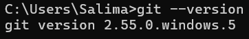

## **Préparation de l’environnement Java**

**Commande exécutée :**

java --version

### Vérification de Java

Voici le résultat de la commande `java --version` :

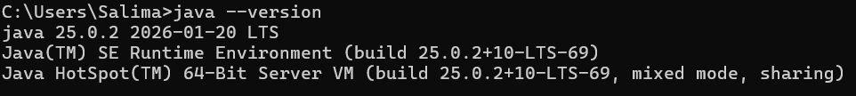

# Activité 1-1 : Première connexion Client/Serveur

## 1. Objectif

Apprendre à établir une communication Client/Serveur (C/S) en Java à l’aide des
sockets en mode connecté TCP.

## 2. Création de l'application serveur

L'application serveur est développée dans le package serverPackage, dans la classe Server.

Le serveur a pour rôle d'attendre une demande de connexion provenant d'un client. Lorsqu'une connexion est établie, il affiche un message dans la console.

### **Code source du serveur**

La classe Server utilise ServerSocket pour écouter les demandes de connexion sur le port 1234. La méthode accept() bloque l'exécution jusqu'à ce qu'un client se connecte. Après l'établissement de la connexion, le serveur affiche un message de confirmation, puis ferme le socket client et le socket serveur.

Voici une capture d'écran du code source de la classe Server :

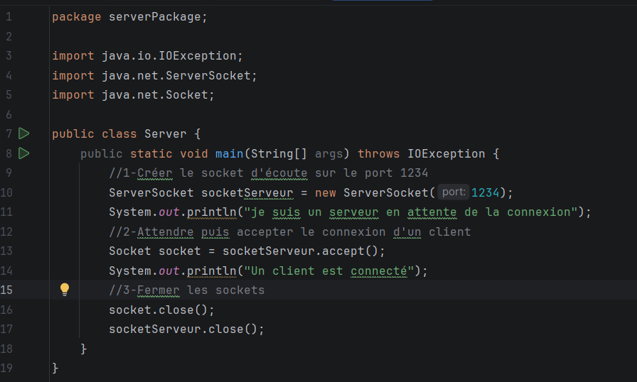

### **Principales instructions utilisées:**

| Instruction Java | Rôle / Description |
| :--- | :--- |
| `new ServerSocket(1234)` | Crée le socket serveur sur le port 1234. |
| `socketServeur.accept()` | Attend et accepte une connexion entrante. |
| `System.out.println()` | Affiche un message dans la console. |
| `socket.close()` | Ferme la connexion avec le client. |
| `socketServeur.close()` | Ferme le socket serveur. |

## 3. Création de l'application client

L'application cliente est développée dans le package clientPackage, dans la classe Client.

Le client utilise la classe Socket pour établir une connexion avec le serveur sur la machine locale (localhost), au port 1234.

### **Code source du client**

La classe Client affiche un premier message, tente de se connecter au serveur, affiche un message de confirmation lorsque la connexion réussit, puis ferme le socket.

Voici une capture d'écran du code source de la classe Client :

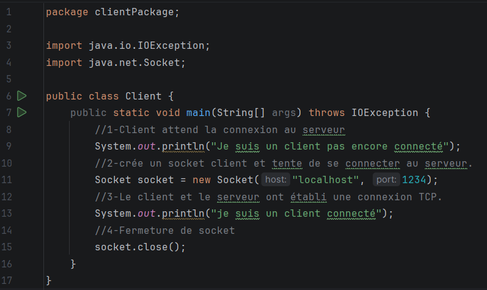

### Principales instructions utilisées:

| Instruction Java | Rôle / Description |
| :--- | :--- |
| `new Socket("localhost", 1234)` | Tente d'établir une connexion TCP avec le serveur. |
| `System.out.println()` | Affiche des messages dans la console. |
| `socket.close()` | Ferme le socket client. |
## 4. Test de la connexion Client/Serveur

L'objectif de ce test est de vérifier que l'application cliente peut établir une connexion TCP avec l'application serveur sur le port 1234.

### Étapes du test

1. Exécuter la classe Server.java afin de démarrer le serveur.
2. Vérifier que le serveur affiche un message indiquant qu'il est en attente d'une connexion.
3. Exécuter la classe Client.java.
4. Vérifier que le client affiche un message confirmant la connexion.
5. Vérifier que le serveur affiche également un message confirmant qu'un client est connecté.

### Résultat obtenu côté serveur

Avant la connexion, le serveur affiche le message suivant :
je suis un serveur en attente de la connexion

**Après la connexion du client, le serveur affiche :**

Un client est connecté

### Résultat obtenu côté client

**Le client affiche d'abord :**

Je suis un client pas encore connecté

**Après l'établissement de la connexion, il affiche :**

je suis un client connecté

### Captures d'écran du test

_**1. Serveur en attente de connexion**_

Le serveur démarre, se met en écoute sur le port 1234 et bloque sur accept().

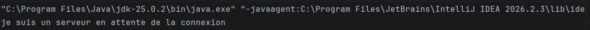

_**2. Client connecté**_

Le client se connecte au serveur via localhost:1234 et affiche son message.

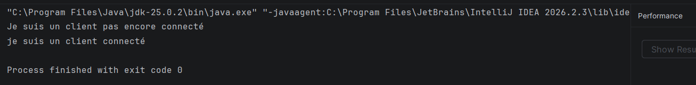

_**3. Serveur après connexion**_

Dès que le client se connecte, le serveur accepte la connexion et affiche le message correspondant.

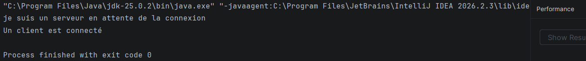

_**Test avec une adresse IP**_

Nous avons remplacé localhost par l'adresse IP 192.168.100.235 dans le client. Le comportement reste identique.

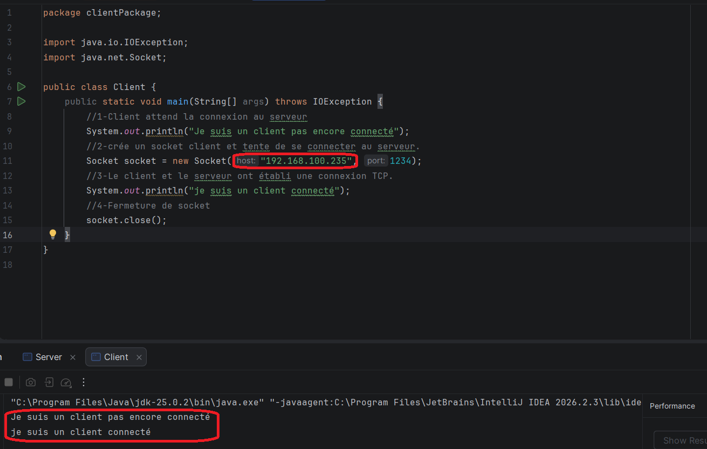

## 5. Conclusion

   Les objectifs de cette activité ont été atteints en mettant en œuvre une première communication client-serveur en Java via le protocole TCP. Nous avons appris à créer un serveur en écoute, à établir une connexion à l’aide d’une adresse IP et d’un port, puis à fermer correctement les sockets.

# Activité 1-2 : Service de calculatrice

## 1. Objectif

L’objectif de cette étape est d’étendre les applications Client et Serveur de l’activité précédente afin de réaliser une opération de multiplication à distance en utilisant le protocole TCP.

## 2. Modification de l'application serveur

L'application serveur est développée dans le package serverPackage, dans la classe Server2.

Le serveur attend la connexion d'un client sur le port 1234. Une fois la connexion établie, il reçoit un entier envoyé par le client, calcule son produit par 5, puis renvoie le résultat au client.

### Code source du serveur:

La classe Server2 utilise ServerSocket pour écouter les demandes de connexion et Socket pour communiquer avec le client. Les classes DataInputStream et DataOutputStream permettent respectivement de recevoir et d'envoyer des entiers.

Voici une capture d'écran du code source de la classe Server2 :

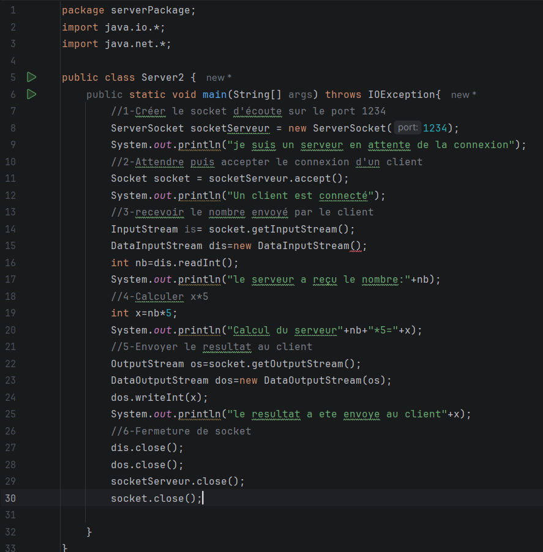

### Principales instructions utilisées

| Instruction Java  | Rôle / Description |
| :--- | :--- |
| `new ServerSocket(1234)` | Crée le socket serveur sur le port 1234. |
| `socketServeur.accept()` | Attend et accepte une connexion entrante. |
| `new DataInputStream(is)` | Crée un flux permettant de recevoir des données. |
| `dis.readInt()` | Lit l'entier envoyé par le client. |
| `nb * 5` | Calcule le produit de l'entier reçu par 5. |
| `new DataOutputStream(os)` | Crée un flux permettant d'envoyer des données. |
| `dos.writeInt(x)` | Envoie le résultat au client. |
| `socket.close()` et `socketServeur.close()` | Ferment les sockets. |
## 3. Modification de l'application client

L'application client est développée dans le package clientPackage, dans la classe Client2.

Le client se connecte au serveur sur le port 1234, demande à l'utilisateur de saisir un entier au clavier, puis envoie cet entier au serveur. Il attend ensuite le résultat du calcul et l'affiche dans la console.

### Code source du client

La classe Client2 utilise Socket pour établir la connexion TCP avec le serveur, Scanner pour lire l'entier saisi au clavier et les classes DataOutputStream et DataInputStream pour envoyer l'entier et recevoir le résultat.

Voici une capture d'écran du code source de la classe Client2 :

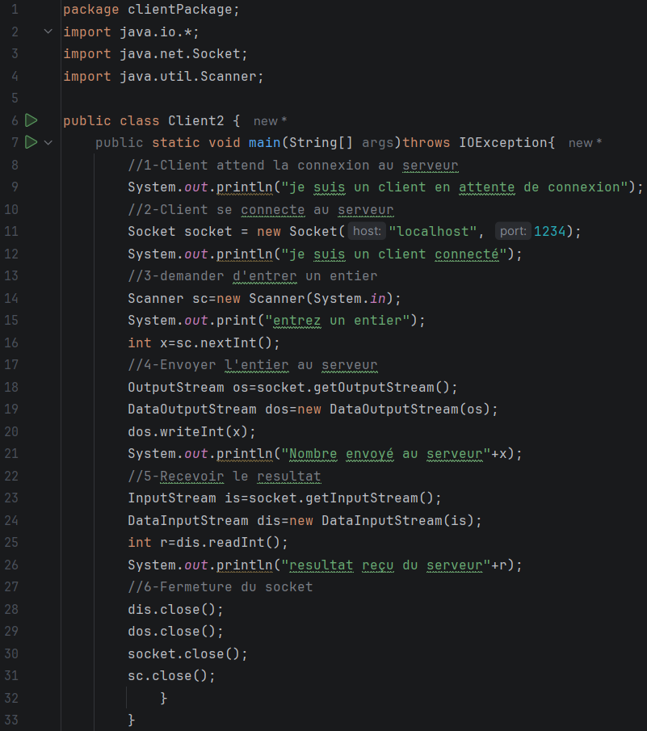

### Principales instructions utilisées
| Instruction Java  | Rôle / Description |
| :--- | :--- |
| `new Socket("localhost", 1234)` | Établit une connexion TCP avec le serveur local. |
| `new Scanner(System.in)` | Permet de saisir un entier au clavier. |
| `dos.writeInt(x)` | Envoie l'entier saisi au serveur. |
| `dis.readInt()` | Reçoit le résultat calculé par le serveur. |
| `System.out.println()` | Affiche les messages et le résultat dans la console. |
| `socket.close()` | Ferme la connexion du client. |

## 4. Test du service de multiplication

### Étapes du test

1. Exécuter la classe Server2.java afin de démarrer le serveur.
2. Vérifier que le serveur affiche un message indiquant qu'il est en attente d'une connexion.
3. Exécuter la classe Client2.java.
4. Saisir un entier au clavier.
5. Vérifier que le serveur reçoit l'entier et calcule son produit par 5.
6. Vérifier que le client reçoit et affiche le résultat.

### Résultat obtenu côté serveur

**Après le lancement du serveur, la console affiche :**

Je suis un serveur en attente de connexion

**Après la connexion du client et l'envoi d'un entier, le serveur affiche par exemple :**

* Un client est connecte
* Le serveur a recu le nombre : 4
* Calcul du serveur : 4 * 5 = 20
* Le resultat a ete envoye au client : 20

### Résultat obtenu côté client

**Après la connexion au serveur, le client affiche :**

* Je suis un client en attente de connexion
* Je suis un client connecte
* Entrez un entier : 4
* Nombre envoye au serveur : 4
* Resultat recu du serveur : 20

### Captures d'écran du test

_**1. Serveur en attente de connexion**_

Le serveur démarre et se met en écoute sur le port 1234.

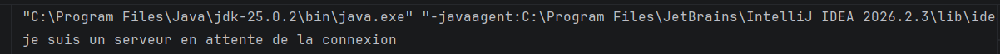

_**2. Client connecté et saisie de l'entier**_

Le client établit la connexion avec le serveur et demande à l'utilisateur de saisir un entier.

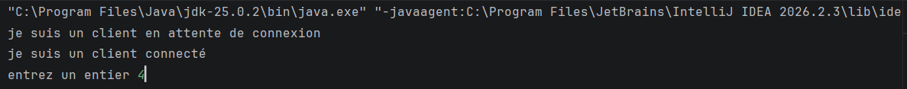

**_3. Calcul effectué par le serveur_**

Le serveur reçoit l'entier, effectue la multiplication par 5 et envoie le résultat au client.

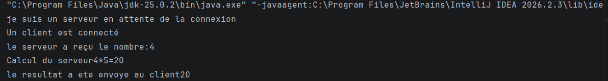

_**4. Résultat reçu par le client**_

Le client affiche le résultat envoyé par le serveur

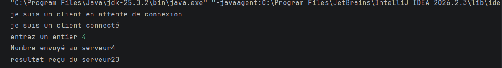

## 5. Modification des applications pour traiter plusieurs entiers

### 5.1. Objectif

Modifier les applications Client et Serveur afin de permettre l'envoi et le traitement de plusieurs entiers successifs au cours d'une même connexion TCP. Le processus continue jusqu'à ce que le client saisisse 0, ce qui entraîne l'arrêt de la communication et la fermeture des sockets.

### 5.2. Modification de l'application serveur

La classe Server2 a été modifiée pour recevoir plusieurs entiers successivement à l'aide d'une boucle while. Pour chaque entier reçu, le serveur vérifie s'il est égal à 0. Si ce n'est pas le cas, il calcule son produit par 5 et renvoie le résultat au client.

Lorsque le serveur reçoit 0, il quitte la boucle et ferme la connexion.

### Principales instructions utilisées :

| Instruction Java  | Rôle / Description |
| :--- | :--- |
| `while (true)` | Permet de traiter plusieurs entiers successivement. |
| `dis.readInt()` | Reçoit un entier envoyé par le client. |
| `if (nb == 0)` | Détecte la demande d'arrêt. |
| `nb * 5` | Calcule le produit de l'entier par 5. |
| `dos.writeInt(resultat)` | Envoie le résultat au client. |
| `dos.flush()` | Force l'envoi des données en attente. |

### Capture d'écran du code source du serveur :

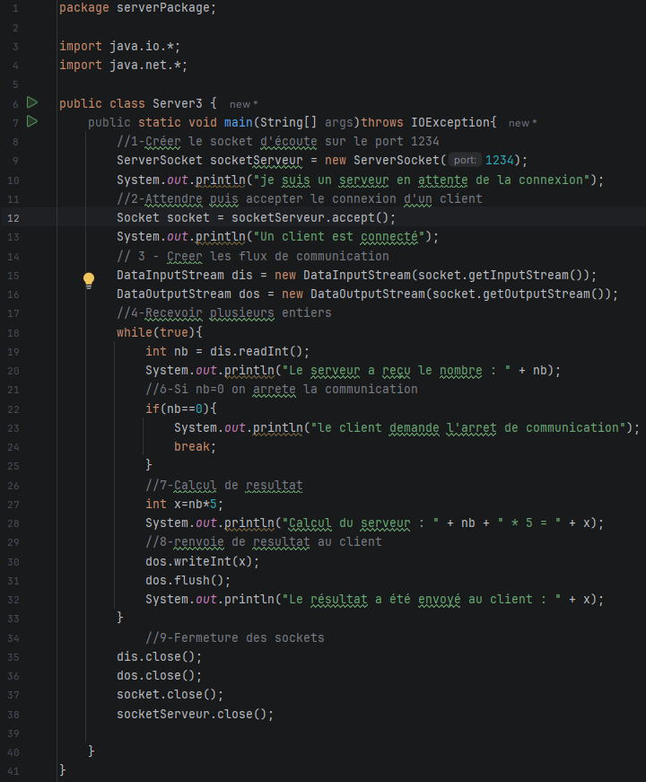

### 5.3. Modification de l'application cliente

La classe Client2 a été modifiée pour permettre à l'utilisateur de saisir plusieurs entiers successivement. Une boucle do...while permet de répéter la saisie, l'envoi de l'entier au serveur et la réception du résultat.

Lorsque l'utilisateur saisit 0, le client envoie cette valeur au serveur et arrête le processus sans attendre de résultat.

### Principales instructions utilisées :

| Instruction Java | Rôle / Description |
| :--- | :--- |
| `do...while (x != 0)` | Répète les opérations tant que l'entier saisi est différent de 0. |
| `dos.writeInt(x)` | Envoie l'entier au serveur. |
| `dis.readInt()` | Reçoit le résultat du calcul. |
| `if (x != 0)` | Évite d'attendre un résultat lorsque l'utilisateur saisit 0. |
### Capture d'écran du code source du client :

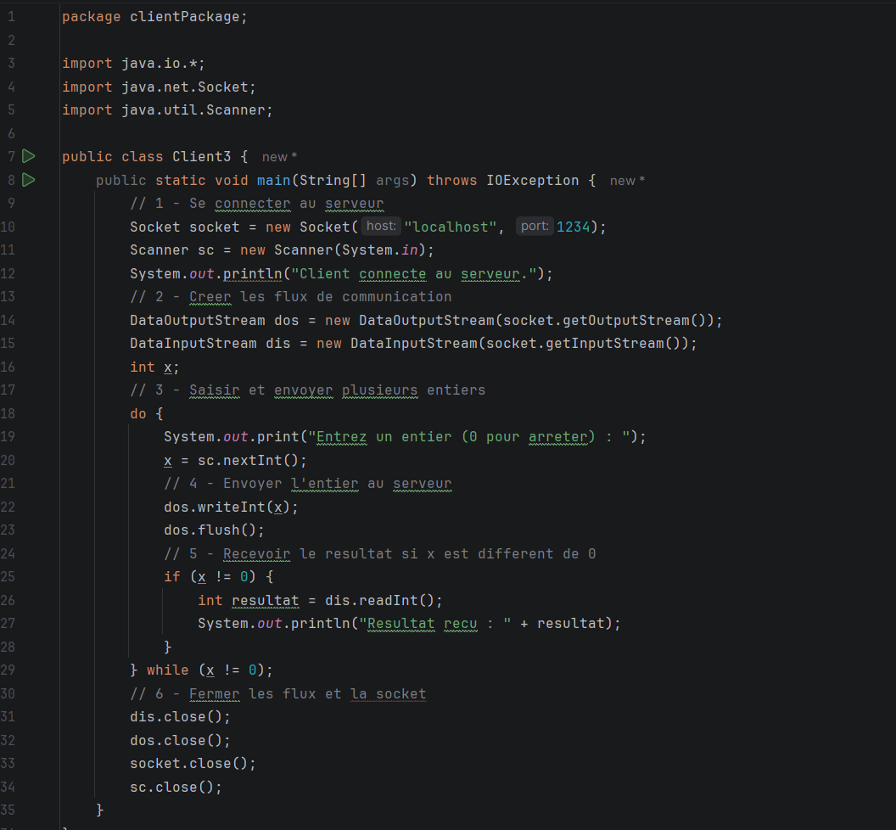

### 5.4. Exécution et tests

Le serveur est lancé en premier, suivi du client. Plusieurs entiers sont saisis successivement afin de vérifier le fonctionnement de la communication et la validité des résultats.

_**Résultat obtenu côté serveur :**_

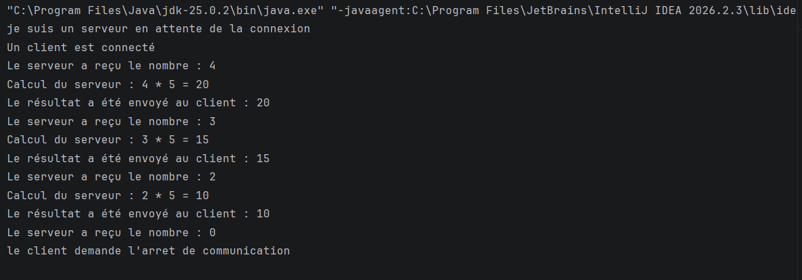

_**Résultat obtenu côté client :**_

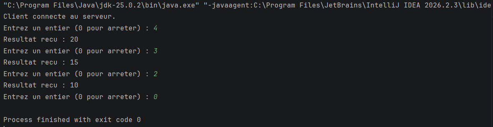

### 5.5. Interprétation des résultats

Les tests montrent que le client peut envoyer plusieurs entiers au serveur au cours d'une même connexion TCP. Le serveur effectue correctement la multiplication par 5 et renvoie chaque résultat au client, y compris pour les entiers négatifs.

La saisie de 0 permet de signaler la fin des échanges. Le serveur quitte alors sa boucle et les sockets sont fermés des deux côtés.

## 6.Conclusion générale

Ce TP nous a permis de mettre en pratique la communication client-serveur en Java à l’aide des sockets TCP, en utilisant les flux d’entrée et de sortie pour envoyer des entiers, recevoir les résultats de multiplication et gérer la fin de la communication.

# **Activité 1-3 : Amélioration sur le service de calculatrice**

## 1. Objectifs de l'activité

* Établir une communication TCP entre deux machines distinctes connectées au même réseau local.

* Utiliser les classes InetAddress et InetSocketAddress pour configurer les adresses réseau.

* Développer une application Client/Serveur permettant d'effectuer quatre opérations arithmétiques.

* Transmettre les choix et les nombres du client vers le serveur.

* Effectuer les calculs côté serveur et retourner les résultats au client.

* Gérer les opérations invalides et la division par zéro.

* Mettre en pratique les échanges de données à l'aide des sockets et des flux d'entrée/sortie Java.

## 2. Environnement de travail

| Élément | Configuration |
|---|---|
| Système du serveur | Windows |
| Système du client | Ubuntu 24.04 LTS |
| Virtualisation | Oracle VirtualBox |
| Langage de programmation | Java |
| Protocole de communication | TCP |
| Adresse IP du serveur | `192.168.1.7` |
| Adresse IP du client | `192.168.1.8` |
| Port de communication | `1234` |
| IDE du serveur | IntelliJ IDEA |
| Mode réseau VirtualBox | Accès par pont (*Bridged Adapter*) |

## 3. Architecture de l'application

L'application repose sur une architecture Client/Serveur répartie sur deux machines :

**Serveur :** exécuté sur Windows, il attend les connexions entrantes, reçoit les opérations et les nombres, effectue les calculs et transmet les résultats.

**Client :** exécuté sur Ubuntu dans une machine virtuelle VirtualBox, il permet à l'utilisateur de sélectionner une opération, de saisir les nombres et d'afficher le résultat reçu.

Les deux machines sont connectées au même réseau local. Le client utilise l'adresse IP du serveur et le port 1234 pour établir la connexion TCP.

## 4. Configuration réseau

Pour permettre la communication entre Windows et Ubuntu, la carte réseau de la machine virtuelle VirtualBox est configurée en mode Accès par pont (Bridged Adapter).

Ce mode permet à la machine virtuelle d'être connectée au même réseau local que la machine hôte.

Les paramètres utilisés sont :

| Paramètre réseau | Adresse / Valeur | Description |
| :--- | :--- | :--- |
| **Adresse IP du serveur** | `192.168.1.7` | Adresse IP de la machine hôte (Windows) hébergeant le serveur. |
| **Adresse IP du client** | `192.168.1.8` | Adresse IP de la machine virtuelle (Ubuntu) exécutant le client. |
| **Port du serveur** | `1234` | Port d'écoute TCP utilisé pour la communication. |

La classe InetAddress permet de représenter l'adresse IP du serveur, tandis que InetSocketAddress associe cette adresse au port de communication.

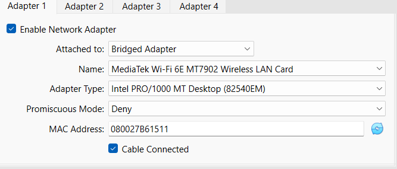

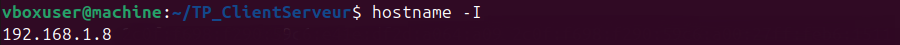

## 5. Implémentation du serveur

Le serveur est développé dans la classe Server4.java et exécuté sur Windows.

**_Ses principales étapes sont :_**

1. Récupérer l'adresse IP du serveur.

2. Créer une socket serveur avec ServerSocket.

3. Associer la socket à l'adresse IP et au port avec bind().

4. Attendre la connexion du client avec accept().

5. Recevoir le choix de l'opération et les deux nombres.

6. Effectuer le calcul correspondant.

7. Envoyer le résultat ou signaler une opération impossible.

8. Fermer les flux et les sockets à la fin de la communication.

### 5.1. Code source du serveur

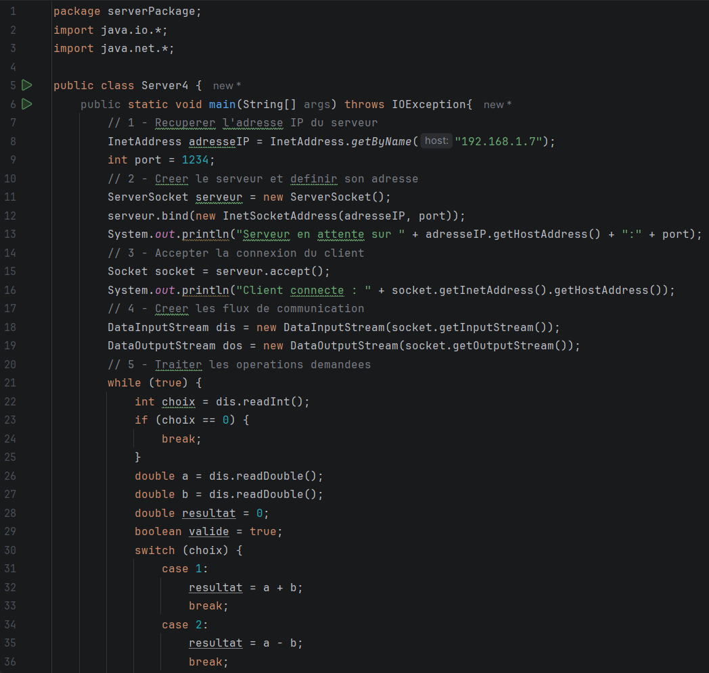
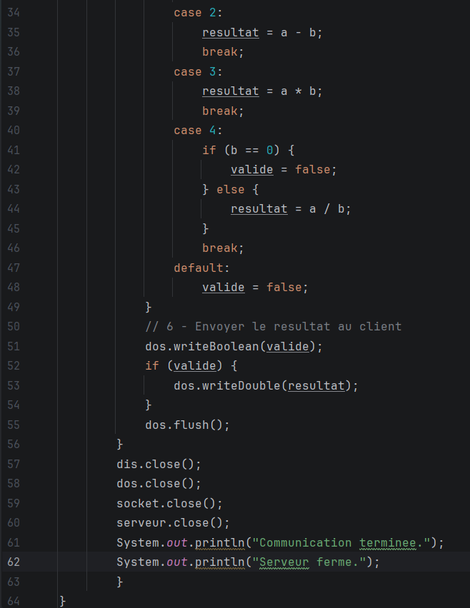

### 5.2. Traitement des opérations

Le serveur utilise une structure switch pour effectuer l'addition, la soustraction, la multiplication ou la division. Il vérifie également que le diviseur n'est pas nul.

## 6. Implémentation du client

Le client est développé dans la classe Client3.java et exécuté sur Ubuntu.

**_Ses principales étapes sont :_**

1. Définir l'adresse IP et le port du serveur.

2. Établir la connexion TCP avec Socket.

3. Créer les flux de communication à l'aide de DataOutputStream et DataInputStream.

4. Afficher un menu permettant de choisir une opération.

5. Demander à l'utilisateur de saisir les deux nombres.

6. Envoyer les données au serveur.

7. Recevoir et afficher le résultat.

8. Fermer la connexion lorsque l'utilisateur choisit l'option 0.

### 6.1. Code source du client

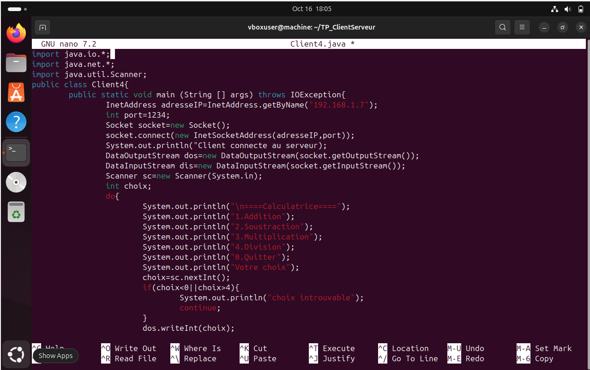
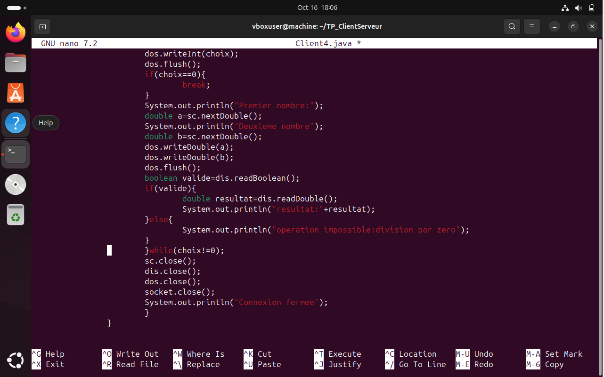

### 6.2. Menu de la calculatrice

_**Le client propose les choix suivants :**_

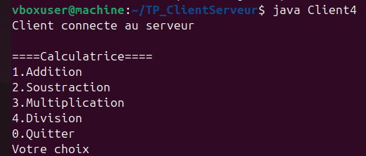

## 7. Protocole d'échange des données

Les données sont échangées entre le client et le serveur à l'aide des flux Java.

Pour chaque opération :

1. Le client envoie un entier représentant le choix de l'opération avec writeInt().

2. Le client envoie les deux nombres avec writeDouble().

3. Le serveur reçoit les données avec readInt() et readDouble().

4. Le serveur effectue le calcul.

5. Le serveur envoie un booléen indiquant si l'opération est valide avec writeBoolean().

6. Si l'opération est valide, le serveur transmet le résultat avec writeDouble().

7. Le client reçoit et affiche le résultat.

Lorsque le client choisit 0, il signale la fin de la communication.

## 8. Tests et résultats

Les tests permettent de vérifier le fonctionnement de la communication TCP et l'exactitude des opérations arithmétiques.

| Choix | Opération | Valeurs saisies | Résultat attendu |
| :---: | :--- | :--- | :--- |
| **1** | Addition | 10 et 5 | 15 |
| **2** | Soustraction | 10 et 5 | 5 |
| **3** | Multiplication | 10 et 5 | 50 |
| **4** | Division | 10 et 5 | 2 |
| **5** | Division par zéro | 10 et 0 | Message d'erreur |
| **6** | Quitter | — | Fermeture de la connexion |

### 8.1. Connexion du client au serveur

La console du serveur affiche un message indiquant qu'il est en attente d'une connexion, puis confirme la connexion du client Ubuntu.

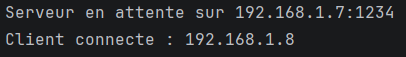

### 8.2. Résultats des opérations

Les tests de l'addition, de la soustraction, de la multiplication et de la division permettent de vérifier que les résultats sont correctement calculés par le serveur et transmis au client.

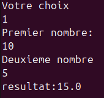
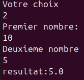
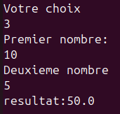
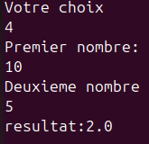

### 8.3. Gestion de la division par zéro

Lorsqu'une division par zéro est demandée, le serveur signale que l'opération est impossible et le client affiche un message d'erreur au lieu d'un résultat numérique.

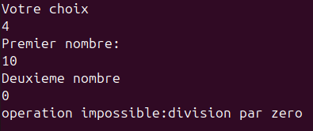

### 8.4. Fin de la communication

Lorsque l'utilisateur choisit l'option 0, le client quitte le menu, ferme les flux et la socket. Le serveur termine ensuite son traitement et ferme ses ressources.

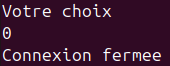
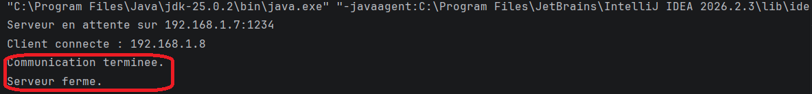

## 9. Conclusion

Cette activité nous a permis de mettre en œuvre une communication Client/Serveur en Java à l'aide des sockets TCP entre deux machines distinctes. Elle nous a également permis de maîtriser l'échange de données, l'exécution d'opérations arithmétiques côté serveur et la gestion des erreurs et de la fermeture de la connexion.

# Conclusion générale

Ce TP nous a permis de comprendre et de mettre en pratique la communication Client/Serveur en Java à l'aide des sockets TCP. À travers les trois activités, nous avons progressivement établi une connexion, réalisé des échanges de données et développé une calculatrice répartie entre deux machines. Ces travaux nous ont permis de mieux comprendre le fonctionnement du modèle Client/Serveur, la transmission des données et la gestion des erreurs et de la fermeture des connexions.

